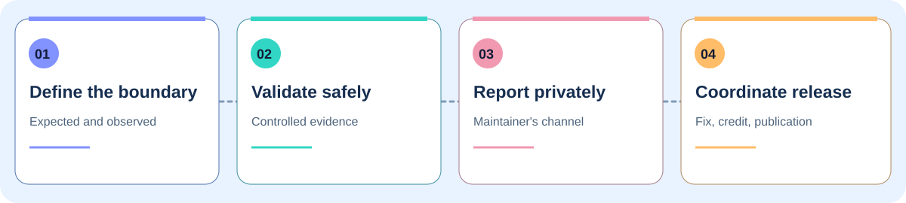

  
    
  

  # Muted Cybersecurity

  **Investigación de seguridad · Pruebas de penetración · Divulgación coordinada de vulnerabilidades**

  [Sitio web](https://mut3dcybersecurity.com/) · [Investigación](https://github.com/MutedCybersecurity/security-research) · [Plantillas](https://github.com/MutedCybersecurity/disclosure-templates) · [English](README.md) · [Contacto](mailto:cybersec@mut3dcybersecurity.com)

Investigamos límites de seguridad, validamos los hallazgos en entornos controlados y colaboramos con los responsables de cada proyecto en la corrección y publicación coordinada. Nuestros repositorios públicos enlazan a avisos originales y ofrecen recursos prácticos para elaborar reportes.

## Áreas de trabajo

<table>
  <tr>
    <td width="33%" valign="top">
       
      <strong>Identidad y acceso</strong> 
      Decisiones de autorización, roles y separación de cuentas.
    </td>
    <td width="33%" valign="top">
       
      <strong>Límites de confianza</strong> 
      Separación entre usuarios, entornos y recursos protegidos.
    </td>
    <td width="33%" valign="top">
       
      <strong>Divulgación coordinada</strong> 
      Evidencia clara, colaboración con mantenedores y publicación cuidadosa.
    </td>
  </tr>
</table>

## Cómo trabajamos

Distinguimos los resultados verificados de las hipótesis, usamos datos sintéticos cuando es posible y tomamos el aviso original del proyecto como fuente principal. Consulta nuestro [método de investigación](https://github.com/MutedCybersecurity/security-research/blob/main/docs/research-approach.md).

## Repositorios principales

<table>
  <tr>
    <td width="50%"></td>
    <td width="50%"></td>
  </tr>
</table>

Los [recursos de marca](brand/README.md) incluyen gráficos reutilizables y ejemplos de atribución.

## Créditos públicos seleccionados

| Proyecto | Aviso | Contribución |
| --- | --- | --- |
| Wagtail | [GHSA-jrgm-fhgv-hmj9](https://github.com/wagtail/wagtail/security/advisories/GHSA-jrgm-fhgv-hmj9) | Reportero |
| Teable | [GHSA-4rch-rfjf-6m86](https://github.com/teableio/teable/security/advisories/GHSA-4rch-rfjf-6m86) | Reportero |
| Teable | [GHSA-w677-p6hx-85vw](https://github.com/teableio/teable/security/advisories/GHSA-w677-p6hx-85vw) | Reportero |

Los avisos originales establecen el alcance y el crédito definitivos. Los reportes privados se añaden a nuestro registro cuando se publican de forma coordinada.

## Contacto

Para colaborar en investigaciones o consultar sobre nuestro trabajo público, escribe a **[cybersec@mut3dcybersecurity.com](mailto:cybersec@mut3dcybersecurity.com)**. Si quieres comunicar una vulnerabilidad de otro proyecto, utiliza su canal privado de seguridad. No publiques detalles inéditos en issues o pull requests.

Para proponer correcciones a este perfil, consulta la [guía de contribución](CONTRIBUTING.md). Los asuntos sensibles deben enviarse siguiendo las [indicaciones de contacto privado](SECURITY.md).
